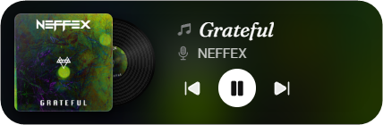

# Needledrop

A tiny always-on-top desktop widget that shows what you are playing — as a record sleeve with a vinyl that slides out and spins while the music plays.



## Features

- Song title, artist and album cover
- Vinyl slides out on play and slowly winds down on pause
- Previous, play/pause and next controls
- Colours adapt to the album art
- Floats above other windows; drag it anywhere
- Works with any player Windows knows about: Spotify, YouTube in the browser, VLC and more
- No logins or API keys needed

## Requirements

- Windows 10 (1809+) or Windows 11
- Any music or video player

## Run it

```bash
npm install
npm run dev
```
